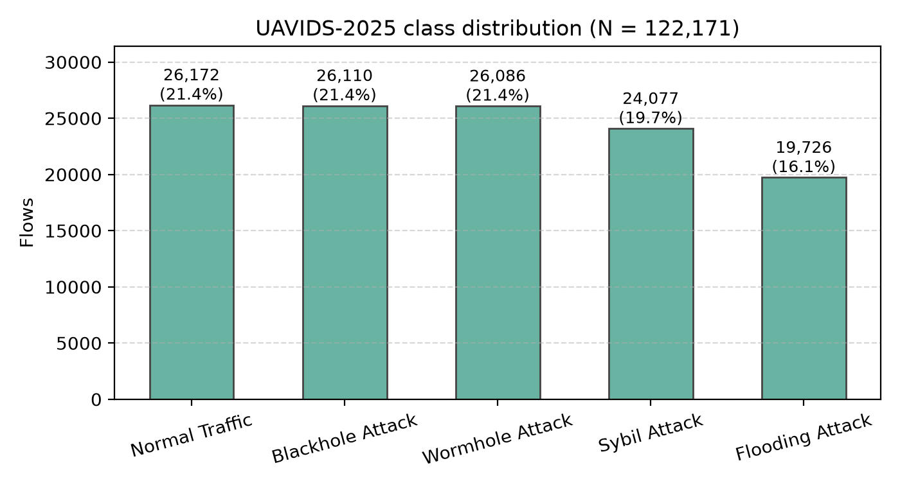

# UAVIDS-2025: Dataset and Benchmark Code

Dataset and reference benchmark code for

> Q. Zeng, A. Bashir, and F. Nait-Abdesselam, "UAVIDS-2025: A Benchmark Dataset for Intrusion Detection in UAV Networks Using Machine Learning Techniques," in *2025 IEEE Conference on Communications and Network Security (CNS)*, pp. 1–9, IEEE, 2025.

UAVIDS-2025 contains **122,171 labelled flow records** from NS-3.24 simulations of a UAV
(FANET) network with BOID swarm mobility, covering normal traffic and four network-layer attacks.
This repository provides the CSV, the preprocessing, and training / evaluation code for the ten
models benchmarked in the paper (LR, SVM, DT, RF, KNN, XGBoost, LightGBM, DNN, CNN, LSTM).

- Dataset page (IEEE DataPort): <https://ieee-dataport.org/documents/uavids-2025-benchmark-dataset-intrusion-detection-uav-networks-using-machine-learning>
- DOI: [10.21227/j5p4-zt27](https://doi.org/10.21227/j5p4-zt27)

> **If you use this dataset or code, please cite the paper — see [Citation](#citation) below.**



## Dataset at a glance

| Class | Flows | Share |
|---|---:|---:|
| Normal Traffic | 26,172 | 21.4 % |
| Blackhole Attack | 26,110 | 21.4 % |
| Wormhole Attack | 26,086 | 21.4 % |
| Sybil Attack | 24,077 | 19.7 % |
| Flooding Attack | 19,726 | 16.1 % |
| **Total** | **122,171** | |

File: [`data/UAVIDS-2025.csv`](data/UAVIDS-2025.csv) (19 MB). One row per flow; 22 feature columns + `label`.

| Group | Columns |
|---|---|
| Connection | `FlowID`, `SrcAddr`, `SrcPort`, `DstAddr`, `DstPort`, `Protocol` |
| Traffic volume | `FlowDuration/s`, `TxPackets`, `RxPackets`, `LostPackets`, `TxBytes`, `RxBytes`, `TxPacketRate/s`, `RxPacketRate/s`, `TxByteRate/s`, `RxByteRate/s`, `MeanPacketSize` |
| Performance | `MeanDelay/s`, `MeanJitter/s`, `Throughput/Kbps`, `PacketDropRate`, `AverageHopCount` |
| Target | `label` ∈ {Normal Traffic, Blackhole Attack, Flooding Attack, Sybil Attack, Wormhole Attack} |

Simulation setup: NS-3.24, Ubuntu 20.04, IEEE 802.11ac, AODV routing, UDP traffic, 100 m
transmission range, 20 dBm transmit power, Nakagami channel, BOID mobility model. See the paper
for details.

### ⚠️ Notes for users of the dataset

1. **Do not use `FlowID` as a feature.** The CSV is ordered by class, so `FlowID` alone predicts
   the label (a Random Forest reaches ≈ 99.98 % accuracy with it, versus ≈ 95 % without).
2. **Drop identifier / constant columns.** `Protocol` is `UDP` for every row, `SrcPort`/`DstPort`
   take only two distinct values, and `SrcAddr`/`DstAddr` are simulation node addresses that are
   scenario-specific. The benchmark code uses the remaining **16 numeric features**.
3. **Near-duplicate flows exist.** 8,205 rows are exact duplicates once `FlowID` is ignored, so a
   random split can place copies of a flow in both train and test. Consider de-duplicating if you
   need a stricter evaluation than the paper's protocol.

## Reproducing the benchmark

Protocol (as in the paper): standardise numeric features (scaler fitted on the training split
only), **80:20 stratified train/test split** (`seed=42`), then train every model on the training
split and report metrics on the held-out test split (24,435 flows).

```bash
git clone https://github.com/QingliZeng/UAV--IDS2025.git && cd UAV--IDS2025
python -m venv .venv && source .venv/bin/activate
pip install -r requirements.txt

PYTHONPATH=src python -m uavids.run                      # all 10 models (~6 min on a laptop CPU)
PYTHONPATH=src python -m uavids.run --models RF XGBoost  # a subset
PYTHONPATH=src python -m uavids.run --seeds 42 43 44     # repeat over other splits / inits
python scripts/plot_results.py                           # regenerate figures
```

Outputs go to `results/`: `results_summary.csv`, `results_all_runs.csv`, `hyperparameters.json`,
and per-model confusion matrices and per-class precision/recall/F1 in `results/confusion/`.

> **macOS note.** `torch` and `xgboost`/`lightgbm` ship conflicting OpenMP runtimes and crash or
> deadlock when loaded into one process. `uavids.run` therefore trains each model in its own
> subprocess. If you write your own script, avoid importing both in the same process. XGBoost on
> macOS also needs `brew install libomp`.

### Models and hyper-parameters

All settings live in [`src/uavids/hparams.py`](src/uavids/hparams.py).

| Model | Configuration |
|---|---|
| LR | `max_iter=1000` |
| SVM | RBF kernel, `C=1`, `gamma="scale"` |
| DT | scikit-learn defaults |
| KNN | `k=5` |
| RF | 100 trees |
| XGBoost | 100 trees, `max_depth=6`, `learning_rate=0.3` |
| LightGBM | 100 trees, `learning_rate=0.1`, `num_leaves=31` |
| DNN | MLP 16→128→64→32→5, ReLU, dropout 0.2 |
| CNN | 1-D conv (32, 64 filters, k=3) over the feature vector → max-pool → FC 64 → 5 |
| LSTM | 1 layer, 64 units, reads the 16 features as a length-16 sequence → FC → 5 |
| Deep models | Adam, lr 1e-3, batch 256, ≤ 50 epochs, early stopping (patience 5) on a 10 % validation split of the training data |

### Results reported in the paper

Overall performance on the 20 % test split (Table IV of the paper):

| Model | Accuracy (%) | Precision (%) | Recall (%) | F1-Score (%) | AUC-ROC |
|---|---:|---:|---:|---:|---:|
| Logistic Regression | 82 | 83 | 82 | 82 | 0.96 |
| SVM | 88 | 89 | 88 | 88 | 0.98 |
| Decision Tree | 93 | 94 | 94 | 94 | 0.96 |
| Random Forest | 95 | 96 | 95 | 95 | 0.99 |
| KNN | 91 | 91 | 91 | 91 | 0.98 |
| XGBoost | 96 | 96 | 96 | 96 | 0.99 |
| LightGBM | 95 | 95 | 95 | 95 | 0.99 |
| DNN | 92 | 93 | 93 | 93 | 0.99 |
| CNN | 93 | 94 | 93 | 93 | 0.99 |
| LSTM | 94 | 94 | 94 | 94 | 0.99 |

Per-class results and normalised confusion matrices for all ten models are in Figs. 2 and 3 of
the paper. This repository provides the code to run the same evaluation yourself; metrics,
confusion matrices and per-class reports are written to `results/` when you run it, and
`python scripts/plot_results.py` draws the confusion matrices. Small differences from the paper's
numbers are expected (library versions, random initialisation, deep-model training schedule).

## Repository layout

```
data/UAVIDS-2025.csv        the dataset
src/uavids/
  data.py                   loading, feature selection, split, standardisation
  hparams.py                all hyper-parameters
  models.py                 classical models (scikit-learn / XGBoost / LightGBM)
  deep.py                   DNN / CNN / LSTM (PyTorch)
  run.py                    train + evaluate, writes results/
scripts/plot_results.py     figures from the CSV and results/
results/                    output directory (created when you run the benchmark)
figures/                    dataset overview figure (+ generated plots)
```

## Citation

If you use the dataset or this code, please cite the paper:

```bibtex
@inproceedings{zeng2025uavids,
  title        = {{UAVIDS-2025}: A benchmark dataset for intrusion detection in {UAV} networks using machine learning techniques},
  author       = {Zeng, Qingli and Bashir, Abdalrahman and Nait-Abdesselam, Farid},
  booktitle    = {2025 IEEE Conference on Communications and Network Security (CNS)},
  pages        = {1--9},
  year         = {2025},
  organization = {IEEE}
}
```

Dataset: Q. Zeng, A. Bashir, F. Nait-Abdesselam, "UAVIDS-2025: A Benchmark Dataset for
Intrusion Detection in UAV Networks Using Machine Learning Techniques," IEEE DataPort, 2025,
doi: [10.21227/j5p4-zt27](https://doi.org/10.21227/j5p4-zt27).

## License

Code: MIT (see [LICENSE](LICENSE)). Dataset: please follow the terms stated on the IEEE DataPort
page above.

## Contact

Qingli Zeng — University of South Carolina Upstate — qingli@uscupstate.edu
Issues and questions are welcome via GitHub Issues.
